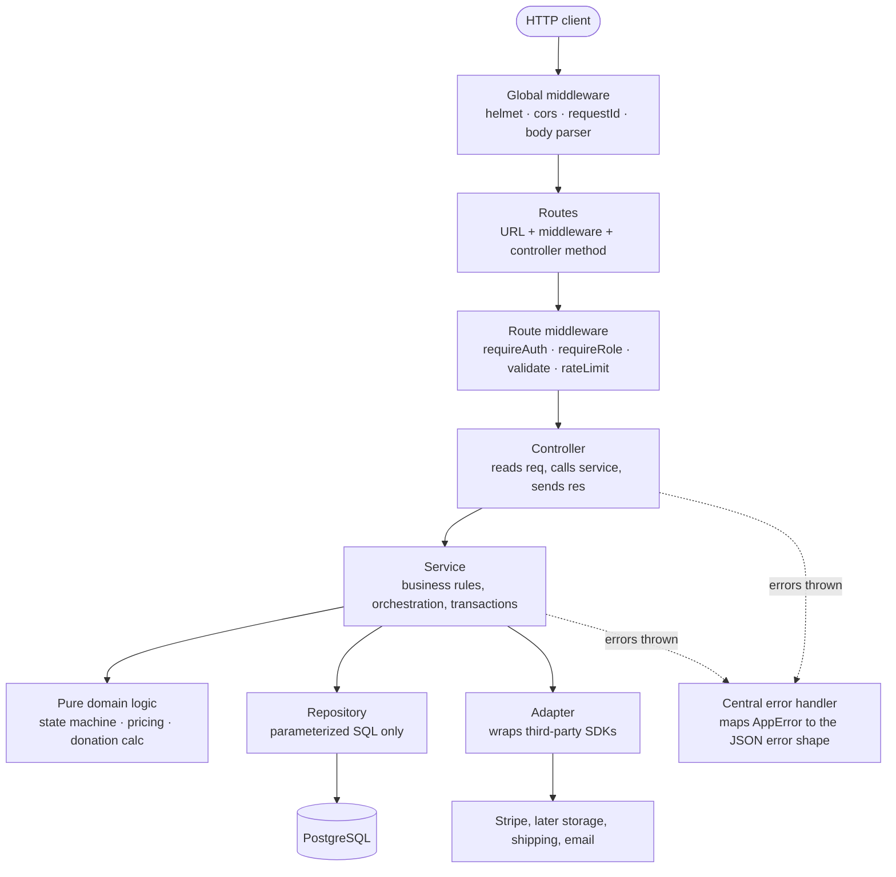
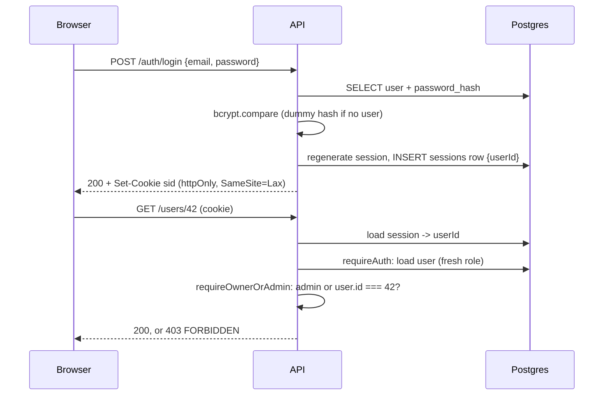

# Architecture

This document describes how the backend is organized and how a request flows through it. It grows as milestones land.

## Layers

The server is organized **by feature module** (auth, users, gallery, commissions, pricing, payments, donations). Each module has the same strict layers. Every layer has a single job, so each one can be understood and tested on its own.



| Layer | Allowed to | Never |
| --- | --- | --- |
| Routes | Map URLs to middleware and controller methods | Contain logic |
| Controller | Read `req`, call a service, send `res` | Write SQL, apply business rules, or catch errors just to re-send them |
| Service | Apply business rules, call repositories, adapters, domain functions, and other modules' services | Touch `req`/`res`, write SQL, or import an SDK |
| Repository | Run parameterized SQL, optionally on a passed-in transaction `client` | Contain business rules |
| Adapter | Import and call a third-party SDK | Know about HTTP or the database |
| Domain logic | Compute results from plain inputs | Access the database, HTTP, or the clock implicitly |

### Why these rules

- **Repository pattern:** all SQL for a table lives in one module. Services ask for data ("find commission by id") without knowing how it is stored. That keeps SQL in one reviewable place and keeps business rules readable.
- **Adapters with dependency injection:** services receive adapters (such as the Stripe adapter) as arguments instead of importing an SDK. Tests can pass a fake, and switching providers only touches the adapter. See [ADR 0002](decisions/0002-es-modules-and-vitest.md).
- **Pure domain logic:** the rules most likely to cost money if wrong (state transitions, quotes, donations) are plain functions, so they get exhaustive unit tests.

## Request lifecycle

Global middleware runs in this order (see `server/src/app.js`):

1. **requestId**: reuses a safe incoming `X-Request-Id` or generates a UUID, sets the response header, and runs the rest of the request inside an AsyncLocalStorage context.
2. **requestLogger**: one log line per request when it finishes (method, path, status, duration).
3. **helmet**: security headers.
4. **cors**: only origins listed in `CORS_ORIGINS` get CORS headers, with credentials (cookies) allowed.
5. **express.json**: parses JSON bodies up to 100 KB.
6. **session**: loads the Postgres-backed session from the signed `httpOnly` cookie.
7. **requireTrustedOrigin**: CSRF check. A POST, PUT, PATCH, or DELETE whose `Origin`/`Referer` is outside `CORS_ORIGINS` gets `403 CSRF_ORIGIN_MISMATCH`.
8. **/api/v1 routes**: feature modules. Per route: rate limiter → `requireAuth` → `requireRole` / `requireOwnerOrAdmin` → `validate` → controller.
9. **notFound**: anything unmatched becomes `404 ROUTE_NOT_FOUND`.
10. **errorHandler**: the only place errors become HTTP responses.

`app.set('trust proxy', TRUST_PROXY)` makes `req.ip` and `req.secure` correct behind Render's load balancer.

### Authentication and authorization



- **Authentication** (`requireAuth`): the session holds only `userId`. The user, including their role, is loaded from the database on every request, so a role change or a deleted account takes effect immediately.
- **Authorization** comes in two flavors. `requireRole('admin')` is for admin-only routes. `requireOwnerOrAdmin(getOwnerId)` is for owned resources and uses the pure `canAccessOwnedResource(user, ownerId)` rule from `lib/authorization.js`. Services can call that rule directly after loading a resource.
- See [ADR 0004](decisions/0004-server-sessions-in-postgres.md) for the cookie flags, CSRF layers, password policy, and rate limits.

### Errors

Code at any layer throws an `AppError` subclass (`NotFoundError`, `ConflictError`, ...). Express 5 forwards both thrown errors and rejected promises to the error handler. The handler turns them into `{ "error": { "code", "message", "details" } }`. Any error that is not an `AppError` is a bug: the client gets a generic `500 INTERNAL_ERROR`, and the real error and stack trace go only to the logs.

### Logging and request IDs

`lib/logger.js` adds the current request ID to every log line through a pino mixin that reads AsyncLocalStorage. A service or repository can log without receiving `req`, and its lines still correlate with the request.

## Request flow (example): sending a quote

`POST /api/v1/commissions/42/quote/send` by an admin:

```mermaid
sequenceDiagram
    participant R as Route + middleware
    participant QC as quotes.controller
    participant QS as quotes.service
    participant CS as commissions.service
    participant SM as stateMachine (pure)
    participant DB as Postgres
    R->>R: requireAuth, requireRole('admin'), validate(params)
    R->>QC: req.validated.params.id = 42
    QC->>QS: sendQuote(42, admin)
    QS->>DB: BEGIN
    QS->>CS: lockCommission(42) → SELECT ... FOR UPDATE
    QS->>DB: find current draft quote
    QS->>QS: total = adjusted ?? computed; splitDeposit(total, DEPOSIT_PERCENT)
    QS->>DB: UPDATE quotes SET status='sent'
    QS->>CS: applyTransition(→ quoted, via 'quote', extraChanges: amounts)
    CS->>SM: assertTransition(commission, 'quoted', admin, {via})
    CS->>DB: UPDATE commissions (status + amounts)
    CS->>DB: INSERT commission_events
    QS->>DB: COMMIT (or ROLLBACK if any step threw)
    QC-->>R: 200 { data: { commission, quote } }
```

Each layer does one job. The controller only translates HTTP. The quotes service orchestrates. The commissions service owns every status change. The state machine decides without touching the database. Repositories hold the SQL. `applyTransition` accepts the caller's transaction client, so the quote update and the status change commit or roll back together.

### Module dependencies

`quotes` → `commissions`, `pricing`. `commissions` → `pricing`. `pricing` depends on nothing. Dependencies run one way: no module imports a module that imports it back, and no module reaches into another's repository.

## Module map

| Module | Responsibility | Milestone |
| --- | --- | --- |
| health | `GET /health`: app status and a database ping | 1 |
| auth | register, login, logout; password hashing; session start and end | 3 |
| users | user records: `GET /users/me`, `GET /users/:id`, admin `GET /users` | 3 |
| commissions | requests, state machine, status changes with event history | 4 |
| pricing | pricing rules and the pure `calculateQuote` engine | 4 |
| quotes | generate, adjust, send, and view quotes (uses commissions + pricing) | 4 |
| gallery | artworks and tags, public listing | 5 |
| payments | Stripe Checkout sessions, webhooks, refunds | 7 |
| donations | donation calculator, ledger, charities, public totals | 8 |
