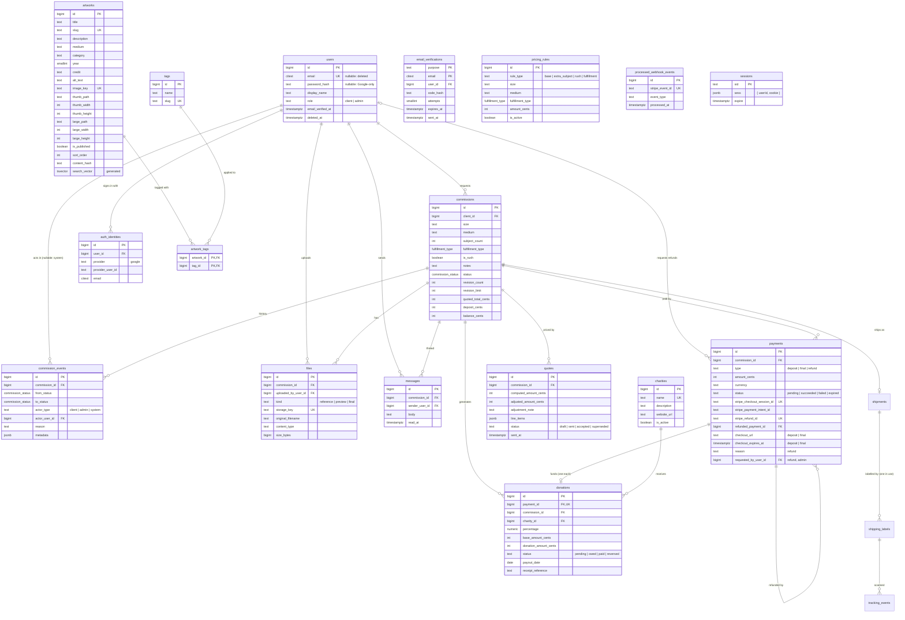

# Data model

The schema is defined by the SQL migrations in [`server/src/db/migrations/`](../server/src/db/migrations/). This document explains it. If the two ever disagree, the migrations are the source of truth, and this file should be fixed.

## Conventions

| Convention | Why |
| --- | --- |
| `id bigint GENERATED ALWAYS AS IDENTITY` | Postgres's standard auto-increment. `ALWAYS` stops the app from inserting its own IDs by accident. `bigint` never runs out. |
| `created_at` / `updated_at timestamptz` | Always time-zone aware. `updated_at` is maintained by the `set_updated_at()` trigger, so code can't forget it or set it wrongly. |
| Money as `integer` cents, with a `_cents` suffix | No floating-point rounding errors. A 32-bit integer holds up to $21,474,836.47 per value. |
| Status columns as `text` + `CHECK` | Easy to change in a migration (unlike `ENUM`, whose values can't be removed). Lists used in several places are **domains** (`commission_status`, `fulfillment_type`): a named type that is `text` plus one shared `CHECK`. |
| Every constraint explicitly named | Tests assert exactly which rule fired, and error mapping can turn a constraint name into an API error code. |
| `ON DELETE RESTRICT` on anything tied to money or history | A user, commission, or payment that has history behind it can't be deleted. `CASCADE` is used only for the artwork↔tag join table. |
| Email as `citext` | Case-insensitive text, so `UNIQUE (email)` treats `Ana@x.com` and `ana@x.com` as the same address. |

## Entity-relationship diagram

`created_at` and `updated_at` are on every table and are omitted from the diagram. `commission_events` has only `created_at`, because events are never updated. `processed_webhook_events` uses `processed_at`. `sessions` follows the column layout required by the connect-pg-simple session store and has no relationships: the user ID lives inside `sess`.

## Tables, constraints, and indexes

### users

| Name | Type | Why |
| --- | --- | --- |
| `users_email_key` | UNIQUE (citext) | One account per email, case-insensitively. Also serves login lookups. |
| `users_email_format_check` | CHECK | A light sanity check (`x@y`, ≤ 254 chars). Real validation is in zod; this stops obvious garbage written by any path. |
| `users_display_name_check` | CHECK | 1 to 100 non-blank characters. |
| `users_role_check` | CHECK | Only `client` or `admin`, so a typo can't create an unknown role that authorization ignores. |
| `users_deleted_fields_check` | CHECK | A live account (`deleted_at` NULL) has an email. A deleted one has no email, password, or verification date, and is a client. Deletion can't leave personal data behind ([ADR 0012](decisions/0012-account-deletion-by-anonymization.md)). |

`password_hash` is nullable: accounts created with Google have no password, and login treats a missing hash exactly like a wrong password. `email_verified_at` records when the owner proved the email (a sign-up code or Google); `NULL` only for accounts from before milestone 5c, which can't log in until claimed with a code ([ADR 0010](decisions/0010-email-verification-and-google-sign-in.md)).

**Deleted accounts are anonymized, not removed** (milestone 7c): commissions and payments reference the row with `ON DELETE RESTRICT`, so it stays as "Deleted user" with `deleted_at` set. Every user query ignores these rows, and the email can sign up again as a new account.

### auth_identities, email_verifications

| Name | Type | Why |
| --- | --- | --- |
| `auth_identities_provider_user_key` | UNIQUE `(provider, provider_user_id)` | One Google account signs in to exactly one user. Users are matched on Google's permanent `sub`, never on email. |
| `auth_identities_user_provider_key` | UNIQUE `(user_id, provider)` | A user links at most one Google account. |
| `auth_identities_provider_check` | CHECK | Only `google` for now. |
| `auth_identities_provider_user_id_check` | CHECK | The provider's account ID is 1–255 characters, so an empty ID can never match. |
| `auth_identities.user_id` | FK, `ON DELETE CASCADE` | A sign-in method means nothing without its user and holds no money or history. |
| `email_verifications_pkey` | PRIMARY KEY `(purpose, email)` | At most one pending code per address and purpose (`signup`, `password_reset`, `email_change`): a new code replaces the old one ([ADR 0014](decisions/0014-password-reset-and-email-change.md), milestone 8d). |
| `email_verifications_purpose_check` | CHECK | Only the three purposes. |
| `email_verifications_user_check` | CHECK | An email-change code belongs to the account that asked for it (`user_id`); sign-up and reset codes are by address alone. |
| `email_verifications.user_id` | FK, `ON DELETE CASCADE` | A pending email change means nothing without its account. |
| `email_verifications_user_id_idx` | Partial index `(user_id) WHERE user_id IS NOT NULL` | Account deletion removes a user's pending email change; serves the foreign key too. |
| `email_verifications_expires_at_idx` | Index `(expires_at)` | Expired codes are deleted whenever a new one is issued. |
| `email_verifications_code_hash_check` | CHECK | A SHA-256 hex digest: only an HMAC of the code is stored, never the code. |
| `email_verifications_attempts_check` | CHECK | Never negative. Five wrong tries use a code up (enforced by the service). |

### artworks, tags, artwork_tags

| Name | Type | Why |
| --- | --- | --- |
| `artworks_slug_key`, `tags_slug_key` | UNIQUE | Slugs are public URLs (`/artworks/:slug`), so they must identify exactly one row. |
| `*_slug_format_check` | CHECK | Lowercase words joined by single hyphens; always URL-safe. |
| `artworks_title_check`, `artworks_category_check`, `tags_name_check` | CHECK | No blank names. |
| `artworks_image_key_key` | UNIQUE | One artwork per processed image. The key links the row to `media/manifest.json` and to its entry in `content/artworks.json`. |
| `artworks_image_key_format_check` | CHECK | Slug format, like every other key. |
| `artworks_thumb_path_check`, `artworks_large_path_check` | CHECK | Only app-served WebP files under `/media/`, and never `..`: no external URLs, no path traversal. |
| `artworks_image_dimensions_check` | CHECK | Widths and heights are positive. The client uses them to reserve space, so pages don't jump while images load. |
| `artworks_alt_text_check` | CHECK | Alt text, when present, is 1–300 characters. |
| `artworks_published_alt_text_check` | CHECK | `NOT is_published OR alt_text IS NOT NULL`: anything the public can see has a description for screen readers. Drafts may lack one. |
| `artworks_year_check` | CHECK | 1900–2100: a sanity range that catches typos, not a business rule. |
| `artworks_credit_check` | CHECK | Credit (e.g. "after Vincent van Gogh"), when present, is 1–200 characters. |
| `artworks_content_hash_check` | CHECK | A SHA-256 hex digest. Set on rows owned by `content/artworks.json`; NULL for rows created through the admin API. The seed rewrites a row only when this hash changes (see [ADR 0007](decisions/0007-content-files-and-media-pipeline.md)). |
| `search_vector` | Generated column (`STORED`) | `setweight(title, A) ‖ setweight(credit + medium + category, B) ‖ setweight(description, C)` in the `english_unaccent` configuration (a copy of `english` that runs the `unaccent` dictionary before stemming, so "guayasamin" matches "Guayasamín"; queries use the same configuration). Postgres recomputes it on every write, so search can never go stale. |
| `artworks_search_idx` | GIN index on `search_vector` | A **GIN** (generalized inverted) index maps each word stem to the rows containing it, so `search_vector @@ websearch_to_tsquery(...)` doesn't scan the table. |
| `is_monochrome` | Column (`boolean`, default false) | Black and white? Measured from the image by `npm run media` (stored in `media/manifest.json`); an entry in `content/artworks.json` can override it with `"monochrome"`. Black-and-white pieces come first in the grid, and the 3D view mixes them with coloured ones (milestone 7e). |
| `in_sketchbook` | Column (`boolean`, default true) | Shown in Explore's 3D sketchbook? Every published piece is in the grid; `"sketchbook": false` in `content/artworks.json` leaves a piece out of the book (milestone 8b). |
| `artworks_published_order_idx` | Partial index `(is_monochrome DESC, sort_order, id) WHERE is_published` | The public gallery's order: black and white first, then the owner's order. A **partial index** contains only the rows matching its `WHERE`, so it stays small. It replaced `artworks_published_sort_idx` (`sort_order, id`) in milestone 7e. |
| `artworks_published_category_idx` | Partial index `(category) WHERE is_published` | The gallery's category filter. |
| `artwork_tags` primary key | `(artwork_id, tag_id)` | Prevents tagging the same artwork twice, and serves "tags of this artwork" lookups. |
| `artwork_tags_tag_id_idx` | Index | "Artworks with this tag": the primary key can't serve this because `tag_id` is its second column. |

Images are not stored in the database. `npm run media` writes WebP files to `media/` and the row stores their paths and sizes; see [ADR 0007](decisions/0007-content-files-and-media-pipeline.md).

### pricing_rules

| Name | Type | Why |
| --- | --- | --- |
| `pricing_rules_rule_type_check` | CHECK | Only the four component types the engine understands. |
| `fulfillment_type_check` | Domain CHECK | `digital`, `physical`, or `mixed_media`; shared with `commissions`. |
| `pricing_rules_amount_check` | CHECK | Amounts are never negative. |
| `pricing_rules_shape_check` | CHECK | Each rule type has exactly the key fields it needs: `base` needs size + medium, `fulfillment` needs a fulfillment type, and `extra_subject` / `rush` have none. A rule can't be half-specified or ambiguous. |
| `pricing_rules_active_key_idx` | Partial UNIQUE `NULLS NOT DISTINCT WHERE is_active` | At most one **active** price per key, so the engine never sees two competing prices. `NULLS NOT DISTINCT` (Postgres 15+) makes `NULL` key fields count as equal; without it, two active `rush` rules would be allowed, because `NULL ≠ NULL` in SQL. Inactive rows are excluded, so old prices can be kept as history. |

### commissions

| Name | Type | Why |
| --- | --- | --- |
| `commission_status_check` | Domain CHECK | Status is one of the 12 real states. *Which transitions* are allowed is the state machine's job (milestone 4); the database guarantees the value itself is valid. |
| `commissions_subject_count_check` | CHECK | At least one subject. |
| `commissions_size_check`, `commissions_medium_check` | CHECK | Not blank. Size and medium are free text, validated against active pricing rules in the service, so a new size is a pricing change rather than a migration. |
| `commissions_revision_count_check` | CHECK | `0 ≤ revision_count ≤ revision_limit`. The revision limit holds even if application code has a bug. |
| `commissions_amounts_check` | CHECK | Money is all-or-nothing and must add up: either no quote yet (all `NULL`), or non-negative amounts where `deposit + balance = total` exactly. |
| `commissions_quoted_amounts_present_check` | CHECK | Past `inquiry`, a commission must have a price. `canceled` is exempt because a commission can be canceled before it was quoted. |
| `commissions_digital_not_shipped_check` | CHECK | Digital-only work can never be `ready_to_ship` or `shipped`. |
| `commissions_client_created_idx` | Index `(client_id, created_at DESC)` | A client's "my commissions" list, newest first. |
| `commissions_status_created_idx` | Index `(status, created_at DESC)` | The admin list filtered by status, newest first. |

`revision_limit` has no default on purpose. It's a business value that the service sets when a commission is created.

### commission_events

An append-only audit trail with one row per status change.

| Name | Type | Why |
| --- | --- | --- |
| `commission_events_actor_type_check` | CHECK | `client`, `admin`, or `system` (for example, a Stripe webhook). |
| `commission_events_actor_user_check` | CHECK | Client and admin events must name the user; system events must not. Every event is attributable. |
| `commission_events_status_changes_check` | CHECK | `from_status ≠ to_status`. `from_status` is `NULL` only for the creation event. |
| `commission_events_metadata_check` | CHECK | `metadata` is a JSON object, never an array or scalar. |
| `commission_events_append_only` | Trigger | Any `UPDATE` or `DELETE` raises an error. An audit trail that can be edited isn't an audit trail. |
| `commission_events_commission_created_idx` | Index `(commission_id, created_at, id)` | One commission's history in order. `id` breaks ties between events in the same transaction. |

### quotes

| Name | Type | Why |
| --- | --- | --- |
| `quotes_status_check` | CHECK | `draft`, `sent`, `accepted`, `superseded`. |
| `quotes_amounts_check` | CHECK | No negative amounts. |
| `quotes_adjustment_note_check` | CHECK | A manual price change must have a non-blank note explaining it. |
| `quotes_line_items_check` | CHECK | `line_items` is a JSON array: a **snapshot** of the engine's breakdown, kept because pricing rules can change after the quote was sent. |
| `quotes_sent_at_check` | CHECK | A `sent` or `accepted` quote must record when it was sent. |
| `quotes_one_current_per_commission_idx` | Partial UNIQUE `(commission_id) WHERE status <> 'superseded'` | At most one current quote per commission. To revise a quote, the old one is marked `superseded` first, so it's always clear which price applies. |
| `quotes_commission_id_idx` | Index | All quotes for a commission, including superseded ones. |

### payments

Every money movement is one row: `deposit`, `final`, or `refund`. Amounts are always positive, and `type` gives the direction.

| Name | Type | Why |
| --- | --- | --- |
| `payments_type_check`, `payments_status_check` | CHECK | Known values only. `expired` covers Checkout sessions that time out unpaid. |
| `payments_amount_check` | CHECK | `amount_cents > 0`. A zero or negative payment is always a bug. |
| `payments_currency_check` | CHECK | A three-letter lowercase ISO code, as Stripe reports it. |
| `payments_refund_link_check` | CHECK | A refund must reference the payment it refunds, and only refunds may. |
| `payments_stripe_ids_check` | CHECK | Refunds never carry a Checkout session ID; incoming payments never carry a refund ID. |
| `payments_stripe_checkout_session_id_key`, `payments_stripe_refund_id_key` | UNIQUE | The same Stripe object can never be recorded twice. This is a database-level backstop for webhook idempotency. |
| `payments_stripe_payment_intent_id_key` | Partial UNIQUE `WHERE type <> 'refund'` | A payment intent is unique among incoming payments. Refunds reuse the intent of the payment they refund, so they're excluded. |
| `payments_one_succeeded_per_stage_idx` | Partial UNIQUE `(commission_id, type) WHERE type IN ('deposit','final') AND status = 'succeeded'` | A commission can be paid successfully at most once per stage. The last line of defense against double-charging if two sessions or webhooks race. |
| `payments_commission_id_idx` | Index | A commission's payments. |
| `payments_refunded_payment_id_idx` | Partial index | Refunds of a given payment, to total what has already been refunded. |
| `payments_checkout_fields_check` | CHECK | `checkout_url` and `checkout_expires_at` (the open Stripe page, reused by a second "Pay" click) belong to incoming payments only. |
| `payments_refund_fields_check` | CHECK | `reason` and `requested_by_user_id` belong to refunds only. A refund with no requester was automatic or made in the Stripe Dashboard. |
| `payments_reason_check` | CHECK | A refund reason is 1–500 characters once trimmed. |
| `payments_checkout_url_check` | CHECK | Checkout URLs are `https://`, so a stored link can never be a `javascript:` URL. |
| `payments.requested_by_user_id` | FK, `ON DELETE RESTRICT` | Money history keeps who asked for each refund. |
| `payments_shipping_cents_check` | CHECK | `shipping_cents` (milestone 11) is the part of a **final** payment that paid for shipping and packaging: 0 to `amount_cents`, and 0 on deposits and refunds. Reported separately; not counted toward the donation. |

### shipments

Milestone 11 ([ADR 0017](decisions/0017-us-shipping-with-shippo.md)): one row per physical commission, with the address (as the carrier standardized it), the package, the Shippo shipment its current prices belong to, and the option the client chose.

| Name | Type | Why |
| --- | --- | --- |
| `shipments_commission_id_key` | UNIQUE | One shipment per commission (address and package are set with `ON CONFLICT` on it). |
| `shipments.commission_id` | FK, `ON DELETE RESTRICT` | A shipment is part of the commission's money history. |
| `shipments_country_check` | CHECK | `US` only (the terms of service). |
| `shipments_state_check`, `shipments_postal_code_check` | CHECK | A two-letter state code; a 5-digit ZIP or ZIP+4. |
| `shipments_address_text_check` | CHECK | Name and street lines 1–100 characters, city 1–60. |
| `shipments_locality_check` | CHECK | City, state, and ZIP come together. |
| `shipments_address_check` | CHECK | A full address has a name, a first line, and a locality (a second line needs a first). Once `address_removed_at` is set (the client deleted their account), only the city, state, and ZIP remain. |
| `shipments_parcel_check` | CHECK | Weight and the three sides all set (positive) or all empty. |
| `shipments_rate_check` | CHECK | A chosen option is complete (rate, carrier, service, postage, packaging fee, when), and needs the quote it came from, the package, and the address (or its removal). |
| `shipments_rate_amounts_check` | CHECK | Postage, packaging fee, and estimated days are never negative. |
| `shipments_set_updated_at` | Trigger | `updated_at` on every change. |
| `shipments.label_quote_id` | Column | Milestone 11b: the Shippo shipment the latest label prices belong to; a label can only be bought from those. Cleared once bought. |

### shipping_labels

Milestone 11b ([ADR 0018](decisions/0018-shipping-labels-and-tracking.md)): postage labels bought through Shippo, with where the package is. The label PDF isn't stored (Shippo gives a fresh link on request). A voided label stays, with its refund.

| Name | Type | Why |
| --- | --- | --- |
| `shipping_labels.shipment_id` | FK, `ON DELETE RESTRICT` | A label is postage paid for: part of the money history. |
| `shipping_labels_provider_transaction_id_key` | UNIQUE | Each Shippo transaction is recorded once. |
| `shipping_labels_one_active_idx` | Partial UNIQUE index (`shipment_id` where `voided_at IS NULL`) | At most one label in use per shipment; any number voided. |
| `shipping_labels_tracking_number_idx` | Index | Tracking webhooks find the label by its tracking number. |
| `shipping_labels_postage_cents_check` | CHECK | What the postage cost the studio is never negative. |
| `shipping_labels_text_check` | CHECK | Transaction ID, carrier, service, and tracking number non-empty and short; tracking details at most 500 characters. |
| `shipping_labels_tracking_url_check` | CHECK | Tracking links are `https://`. |
| `tracking_status` | Domain (`tracking_status_check`) | `unknown`, `pre_transit`, `transit`, `delivered`, `returned`, `failure`, as Shippo reports them. Shared with `tracking_events`. |
| `shipping_labels_refund_check` | CHECK | A voided label has a refund ID and status (`queued`, `pending`, `success`, `error`); a label in use has neither. |
| `shipping_labels_set_updated_at` | Trigger | `updated_at` on every change. |

### tracking_events

The carrier's scans for a label, from Shippo. Written once, never changed (no `updated_at`). The place is the carrier facility's town, never the delivery address.

| Name | Type | Why |
| --- | --- | --- |
| `tracking_events.label_id` | FK, `ON DELETE RESTRICT` | Scans belong to their label's history. |
| `tracking_events_label_event_key` | UNIQUE | Shippo's ID for each scan, per label: a repeated webhook (Shippo's aren't idempotent) adds nothing. |
| `tracking_events_text_check` | CHECK | Scan ID 1–100 characters; details at most 500, city 100, state 50. |

### processed_webhook_events

| Name | Type | Why |
| --- | --- | --- |
| `processed_webhook_events_stripe_event_id_key` | UNIQUE | The webhook handler inserts the event ID first, in the same transaction as its effects. A duplicate delivery fails this constraint and is skipped, so each Stripe event is processed exactly once. |

### files, messages

Only the tables exist so far; the endpoints come in a later phase.

| Name | Type | Why |
| --- | --- | --- |
| `files_kind_check` | CHECK | `reference` (the client's photo), `preview` (watermarked work in progress), or `final` (the deliverable). |
| `files_storage_key_key` | UNIQUE | Each stored object is described by exactly one row. |
| `files_dimensions_check` | CHECK | `width` and `height` both set (positive) or both empty: images have a size, a PDF has none (milestone 10). Written as `(width IS NULL) = (height IS NULL) AND …` so a half-filled pair can't pass as "unknown". |
| `files_original_filename_check` | CHECK | The uploader's file name, 1–200 characters, never containing `/` or `\` (a name, not a path). |

Files are used from milestone 10 ([ADR 0016](decisions/0016-commission-files-on-r2.md)): the bytes live in a private R2 bucket under `storage_key` (`commissions/<id>/<kind>/<uuid>.<ext>`); rows are deleted, with their objects, when the keeping period ends (90 days after a commission ends for reference photos; a year after full payment for previews and final files).
| `files_size_check` | CHECK | `size_bytes > 0`. |
| `files_content_type_check` | CHECK | A MIME type shape such as `image/jpeg`. |
| `files_commission_kind_idx` | Index `(commission_id, kind)` | "Previews for this commission". |
| `messages_body_check` | CHECK | No blank messages. |
| `messages_commission_created_idx` | Index `(commission_id, created_at, id)` | A commission's thread, in order. |

### charities, donations

| Name | Type | Why |
| --- | --- | --- |
| `charities_name_key` | UNIQUE | No duplicate charities. |
| `charities_name_check` | CHECK | The name is 1–200 characters once spaces are trimmed (never blank). |
| `charities_website_url_check` | CHECK | Must be an http(s) URL. |
| `charities_one_active_idx` | Partial UNIQUE on `(true) WHERE is_active` | At most one active charity, so "the currently active charity" is never ambiguous. Every active row has the same index key (`true`), so a second active row is a duplicate. |
| `donations_status_check` | CHECK | `pending`, `owed`, `paid`, or `reversed`. |
| `donations_percentage_check` | CHECK | `0 < percentage ≤ 100`. It's stored per row so past donations keep the rate they were made at. |
| `donations_amounts_check` | CHECK | Amounts are non-negative, and the donation never exceeds its base. |
| `donations_paid_has_payout_date_check` | CHECK | A `paid` donation must have a payout date. |
| `donations_payment_id_key` | UNIQUE | One donation per payment, so a replayed webhook can never create a second donation. |
| `donations_charity_id_idx`, `donations_status_idx`, `donations_created_at_idx` | Index | The admin filters: by charity, by status, and by month (a `created_at` range). |
| `donations_commission_id_idx` | Index | Donations for one commission. |
| `donations_tree_count_check` | CHECK | Tree donations (milestone 8) fund at least one tree. |
| `donations_tree_amount_check` | CHECK | A tree donation costs exactly $1 a tree: `donation_amount_cents = tree_count × 100`. |
| `donations_requested_fields_check` | CHECK | An `owed` or `paid` tree donation has the time it was requested. Digital Humani's request ID is recorded when known; it's null when a retry found the trees already counted under the commission's reference (the API counts a reference's trees but can't list its requests; relaxed in milestone 8c). |
| `donations_tree_request_id_key` | UNIQUE | One Digital Humani request is never recorded twice. |
| `donations_pending_trees_idx` | Partial index `(id) WHERE status = 'pending' AND tree_count IS NOT NULL` | The retry finds tree requests that haven't gone through. |

**Tree donations** ([ADR 0013](decisions/0013-giving-through-digital-humani.md)): the final payment records one, `pending`. `request_attempted_at` is stamped and committed before calling Digital Humani, so a lost answer is detected: the retry asks Digital Humani how many trees it already has under the commission's reference and plants only what's missing, never twice. Once accepted, the row is `owed` (the planting partner will invoice the owner) with `requested_at`, and `tree_request_id` when a new request was made. The refund flow never refunds a commission's tree money.

### sessions

Server-side login sessions (milestone 3, [ADR 0004](decisions/0004-server-sessions-in-postgres.md)). The browser holds only the signed `sid` in an `httpOnly` cookie.

| Name | Type | Why |
| --- | --- | --- |
| `sessions_pkey` | PRIMARY KEY `(sid)` | Every request looks up its session by ID. |
| `sessions_expire_idx` | Index | The store's periodic cleanup deletes `WHERE expire < now()`. |

## Deliberately deferred

- **Donation adjustment history** for partial refunds is designed in milestone 8, where the audit rules are decided.
- **Shop tables** (`products`, `orders`, ...) come in a later phase. `donations.payment_id` and `commission_id` will be revisited then.
