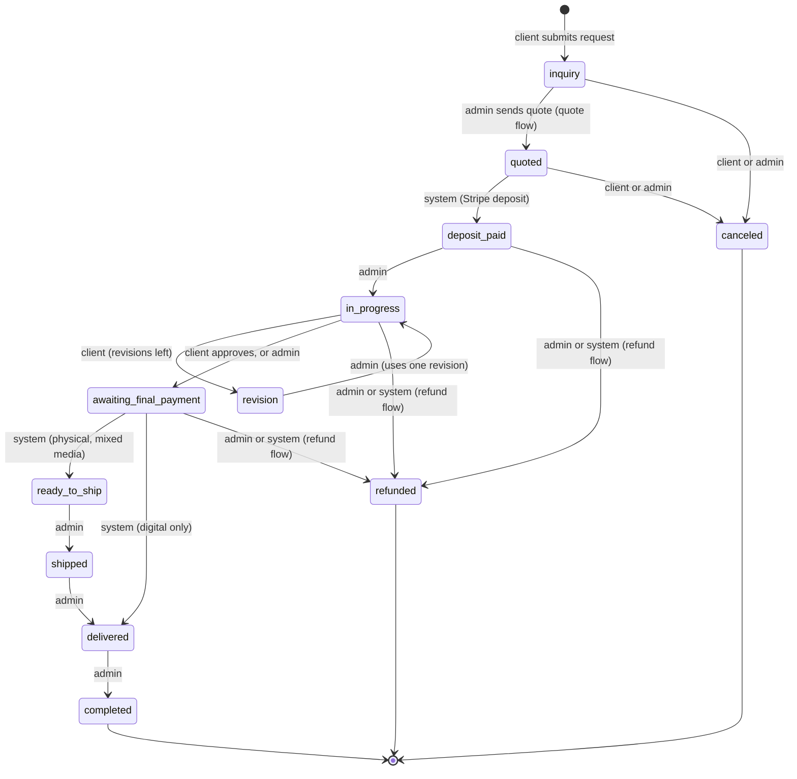

# Commission state machine

Every commission moves through a fixed set of statuses. Allowed changes are defined in one pure module, [`commissions.stateMachine.ts`](../server/src/modules/commissions/commissions.stateMachine.ts), which has no database or HTTP access. The service applies a change by updating the commission and inserting a `commission_events` row **in the same database transaction**, so the status and its audit trail can never disagree.

## Diagram

## Transition table

"Client" means the commission's **own** client. "System" means an automatic actor with no user, such as the Stripe webhook (milestone 7).

| From | To | Who | Rule |
| --- | --- | --- | --- |
| inquiry | quoted | admin | Only through **send quote**, which also records the price |
| inquiry | canceled | client, admin | |
| quoted | canceled | client, admin | |
| quoted | deposit_paid | system | Stripe deposit payment succeeded |
| deposit_paid | in_progress | admin | |
| deposit_paid | refunded | admin, system | Only through the **refund flow** (milestone 7) |
| in_progress | revision | client | Only while `revision_count < revision_limit` |
| in_progress | awaiting_final_payment | client, admin | The client approves the final design (or the admin moves it on) |
| in_progress | refunded | admin, system | Only through the refund flow |
| revision | in_progress | admin | `revision_count` increases by 1 |
| awaiting_final_payment | ready_to_ship | system | Physical or mixed-media only; final payment succeeded |
| awaiting_final_payment | delivered | system | Digital only; final payment succeeded |
| awaiting_final_payment | refunded | admin, system | Only through the refund flow |
| ready_to_ship | shipped | admin | |
| shipped | delivered | admin | A carrier webhook will do this later |
| delivered | completed | admin | |
| completed, canceled, refunded | — | — | Terminal: no further changes |

## Errors

A rejected change returns one of three errors, so the client can tell *why* it failed:

| Status | Code | Meaning | Example |
| --- | --- | --- | --- |
| 409 | `COMMISSION_INVALID_TRANSITION` | The move doesn't exist for this commission | `inquiry → shipped`; shipping digital-only work; any move out of a terminal status; using the generic endpoint for `→ quoted` |
| 403 | `COMMISSION_TRANSITION_FORBIDDEN` | The move exists, but not for this actor | A client trying `deposit_paid → in_progress`; a client acting on someone else's commission |
| 422 | `REVISION_LIMIT_REACHED` | A business rule blocks it | Requesting a third revision when the limit is 2 |

## Design notes

- **Data, not if/else chains.** Transitions are a list of `{ from, to, actors, guard?, effect?, via? }`. Adding a status is a data change, and the full rule set can be read and tested in one place.
- **Dedicated flows (`via`).** `→ quoted` and `→ refunded` must do more than change the status: record the price, or move money. The generic status endpoint can't trigger them. Only the quote flow (and, in milestone 7, the refund flow) can.
- **Concurrency.** The service locks the commission row (`SELECT ... FOR UPDATE`) inside the transaction before checking the rules. If two requests try to change the same commission at once, the second waits and then sees the first one's result, so it can't act on a status that's already out of date.
- **Defense in depth.** The database independently refuses invalid status values, shipping states for digital work, revision counts above the limit, and any edit or deletion of an event row (see [data-model.md](data-model.md)).
- **Tests.** The unit tests check all 144 status pairs against all three actor types, using an expected table written independently of the implementation. A deliberate mutation (letting clients start work) is caught by the suite.
